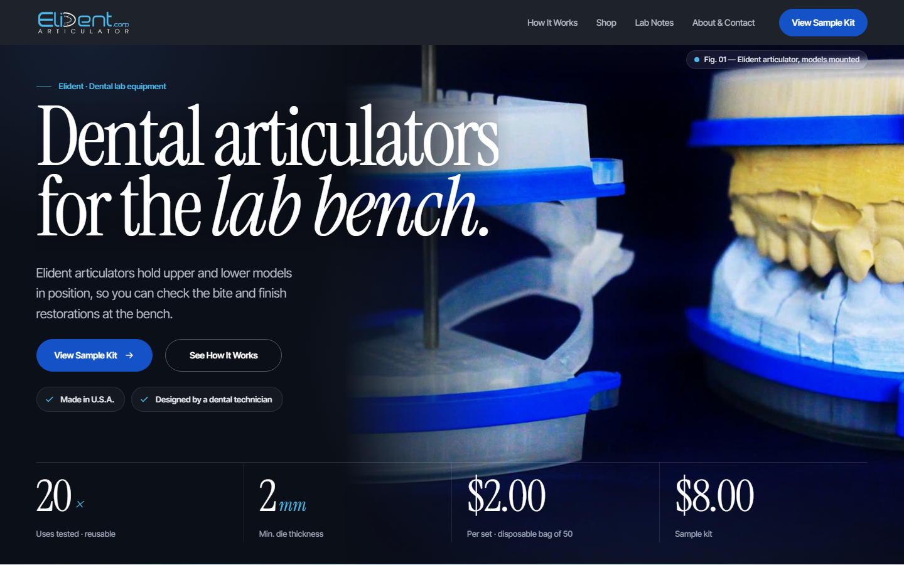
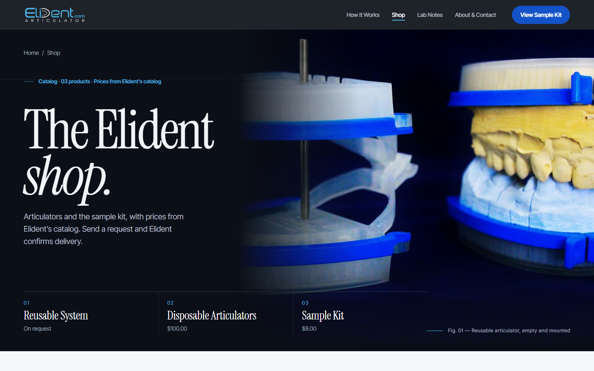
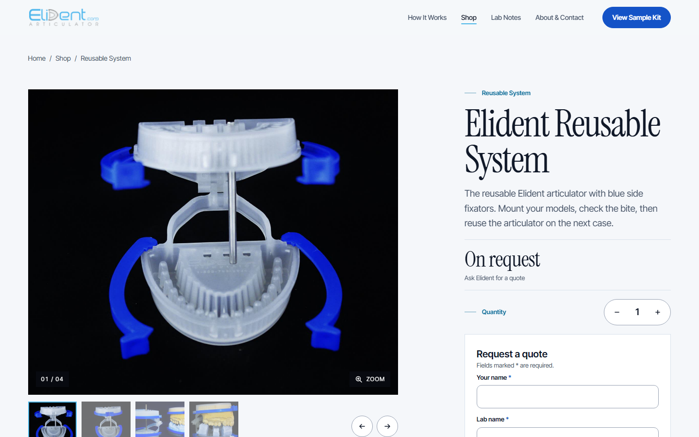
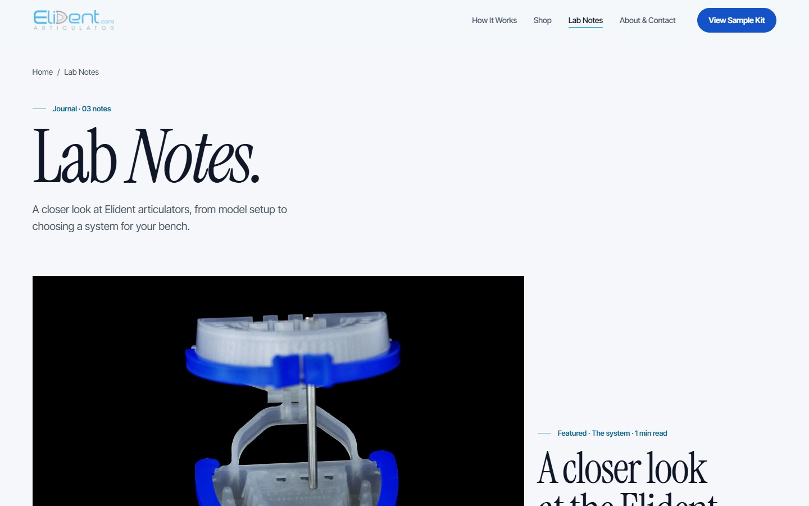
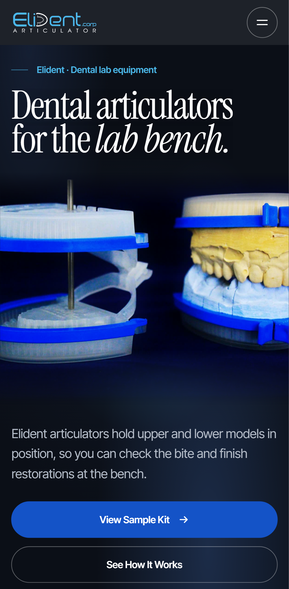
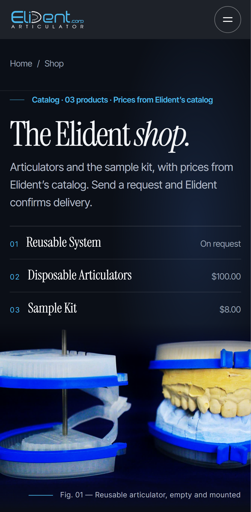

# Elident — articulator website (concept)

A concept website for a dental-lab product: two articulator systems, a sample kit, a lab journal and a contact page. Built as a fully static site with Astro, with a motion layer in GSAP and a set of hand-tuned interactions.

> **Status:** concept prototype. Testimonials, lab logos and some specifications are placeholder content, marked in the source. The domain in `src/data/content.ts` is a placeholder. The product name, photos and copy belong to Elident and are used here for a portfolio demonstration only.



| Shop | Product | Lab Notes |
| --- | --- | --- |
|  |  |  |

Phone:  

Motion: [`docs/screenshots/home-scroll.mp4`](docs/screenshots/home-scroll.mp4) — a scroll through the home page with the pinned "How It Works" scene, reveals and the photo transitions.

## The brief

A lab buyer needs to understand two products quickly and decide which one fits their bench: a reusable articulator and a disposable one, plus a low-risk way to try either. The site had to feel like a product made by people who work at a bench, not a catalogue template.

## What the site does

- **Home.** An editorial hero with count-up figures, a statement whose words light up on scroll, a pinned three-step "How It Works" scene driven by scroll, a side-by-side system comparison, a disposable-cost calculator, testimonials, the sample kit, an FAQ with keyboard navigation and a founder section.
- **Shop.** A segmented filter with a sliding indicator and a FLIP re-layout when the list changes. On phones the filter becomes a 2×2 grid.
- **Product pages.** Photo gallery with thumbnails, arrow keys, zoom, a quantity control and a request form with inline validation, a sending state and an on-page confirmation. The form does not submit anywhere yet; it is a prototype.
- **Lab Notes.** A featured article, a list and article pages with related reading.
- **About & Contact.** Story, chapters and contact details, with a link to Google Maps.
- **404 page**, skip link, Open Graph and canonical tags, favicon.

## Technical decisions

- **Static output.** Every page is pre-rendered by Astro, so the site needs no server. Interactive behaviour is one client script (`src/scripts/site.ts`) that adds state to the rendered markup. The source of the original prototype was a runtime-compiled template; porting it to static pages made the site faster and easier to test.
- **Content as data.** Products, steps, notes and copy live in `src/data/content.ts`. Pages render from that data, so changing a price or a note does not touch markup.
- **Motion with restraint.** GSAP and ScrollTrigger drive the reveals, the split headings and the pixel transitions. Lenis adds smooth scrolling for fine pointers. Everything is disabled under `prefers-reduced-motion`.
- **One intro per visit.** The logo curtain plays once per browser tab (`sessionStorage`). Page changes use a pixel-square transition instead.
- **Keyboard and screen readers.** Tabs, the accordion and the gallery use the ARIA patterns with arrow-key handling. A skip link, visible focus rings and alt text on every image are covered by tests.
- **Lighter photos.** The JPEG photos were re-encoded (≤1600 px wide, quality 5), which halved the image weight from 3.2 MB to 1.6 MB.

## Quality checks

| Check | Result |
| --- | --- |
| Type check (`astro check`) | 0 errors |
| Build | 11 static pages |
| Internal links and anchors (`scripts/check-links.mjs`) | 485 of 485 resolve |
| Browser tests (Playwright, desktop and phone) | 62 of 62 pass |
| Lighthouse, home page | Accessibility 96, Best Practices 100, SEO 100, Performance 85–94 (varies between runs) |

The Playwright suite covers: every page renders without console errors and without horizontal scroll; the 404 page; the footer link; the intro plays once per tab; the FAQ; the cost calculator; the shop filter; the order form (validation, then confirmation); the menu navigation; image alt text, language and titles; visible focus; the skip link.

## Run it

Requires Node.js 18.17 or newer.

```bash
npm install
npm run dev        # development server on http://127.0.0.1:4321
npm test           # type check, build and link check
npx playwright test  # browser tests (starts a preview server itself)
```

Screenshots and the scroll video can be regenerated after `npm run build` and `npm run preview`:

```bash
node scripts/capture-portfolio.mjs   # docs/screenshots/*.png and home-scroll.webm
node scripts/screenshots.mjs <dir>   # full-page captures of every page for review
```

## Project structure

```
src/
  components/   Header, Footer, Arrow
  data/         content.ts — products, steps, notes, copy, contact details
  layouts/      Base.astro — document head, intro, header, footer, skip link
  pages/        index, shop, product/[id], notes/index, notes/[slug], about, 404
  scripts/      site.ts — interactions, GSAP motion, transitions
  styles/       site.css (design system), overrides.css (fixes on top of it)
public/         photos (_blob), fonts, favicon, robots.txt
tests/          Playwright specs
scripts/        link checker, screenshot and capture tools
docs/           screenshots, video and Lighthouse report
```

## Known limitations

- Testimonials, lab logos and the sample-kit contents are placeholders.
- The order and quote forms do not send requests; there is no backend.
- Motion was checked with automated tests and by reviewing screenshots; it has not been reviewed on every real device.
- Lighthouse performance varies between runs; the main cost is render-blocking GSAP scripts in the document head.
- The domain in the metadata is a placeholder (`https://elident.example`).

## License and rights

This is a demonstration project. It is not open source and carries **no licence to reuse** the code, design or content.

- The code and layout are the work of the author of this repository. Reuse needs written permission from the author.
- The name Elident, product photos, product descriptions and prices belong to Elident. They appear here only to show the work. Publishing or reusing them needs Elident's permission.
- Testimonials, lab logos and some specifications are placeholders, not real quotes or customers.

## Credits

- Fonts: Instrument Serif, Inter Tight, Instrument Sans and IBM Plex Mono, under the SIL Open Font License (`public/fonts`).
- Animation: GSAP with ScrollTrigger and SplitText, Lenis.
- Framework: Astro. Tests: Playwright.
